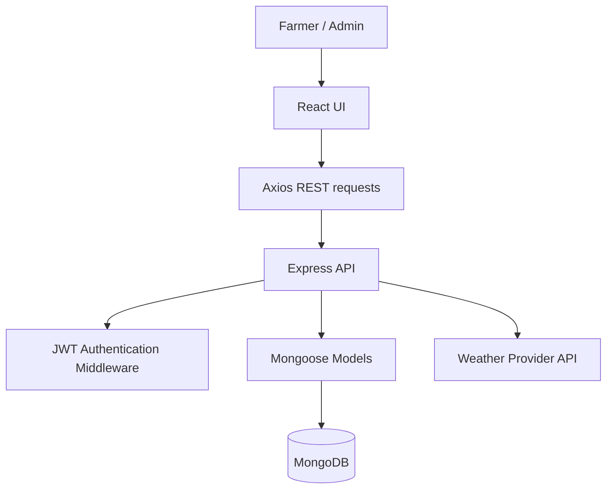
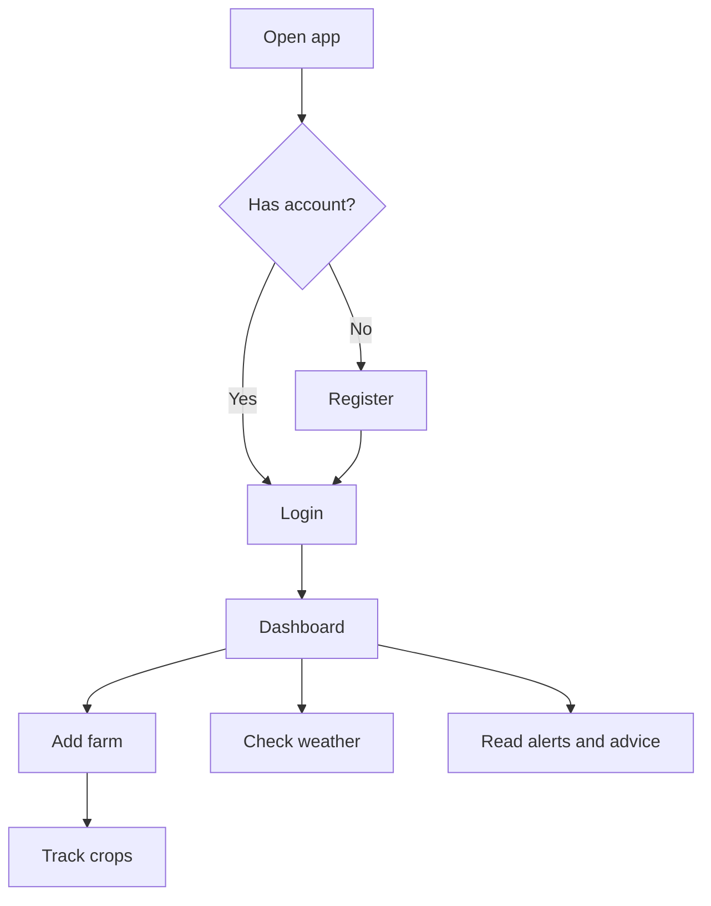
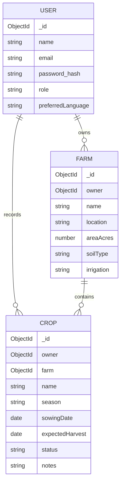

# AgriTech — Project Architecture

## 1. Overview
AgriTech is a MERN full-stack prototype that lets a farmer maintain farm and crop records, check weather information, and view general farming reminders.

## 2. Technical architecture

## 3. MVC pattern
- **Model:** `server/src/models` — User, Farm, Crop schemas.
- **View:** `client/src` — React components and styles.
- **Controller / route handlers:** `server/src/routes` — request validation, data access and responses.
- **Middleware:** authentication, error handling and CORS configuration.

## 4. Roles and responsibilities
| Role | Responsibilities |
|---|---|
| Farmer | Register/login, manage own farm records, create/update/delete own crop records, view weather and advice |
| Admin | Reserved role for future admin dashboard/content moderation; never allow public self-selection of admin role |
| External weather service | Supplies current weather data when an API key is configured |

## 5. User flow

## 6. Entity relationship diagram

## 7. Backend structure
- `src/server.js` — Express app, middleware and route registration
- `src/config/db.js` — MongoDB connection
- `src/models/` — Mongoose schemas
- `src/routes/` — REST endpoints
- `src/middleware/auth.js` — JWT verification
- `src/middleware/errorHandler.js` — API error responses

## 8. Frontend structure
- `src/App.js` — navigation, dashboard and page components
- `src/api.js` — Axios client and token header
- `src/styles.css` — responsive styling
- `public/index.html` — app entry HTML

## 9. Security and validation
- Passwords are hashed with bcryptjs.
- JWT tokens expire after seven days.
- Farm/crop queries are scoped to the authenticated user.
- Input validation is performed for required fields.
- `.env` is ignored by Git. Use HTTPS and a strong JWT secret in deployment.
- For production, consider rate limiting, stricter CORS, refresh-token strategy, audit logging and automated tests.
